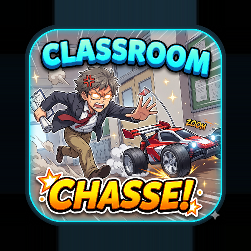
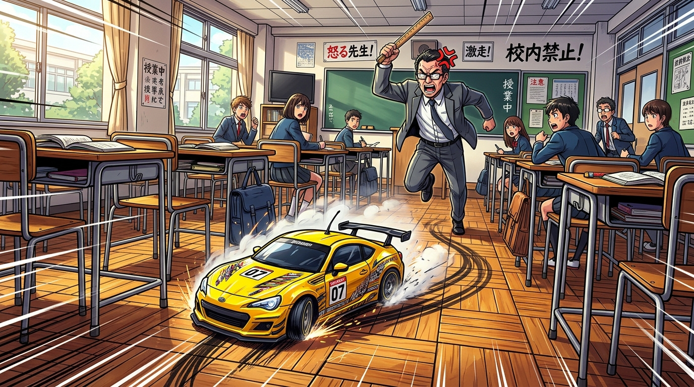
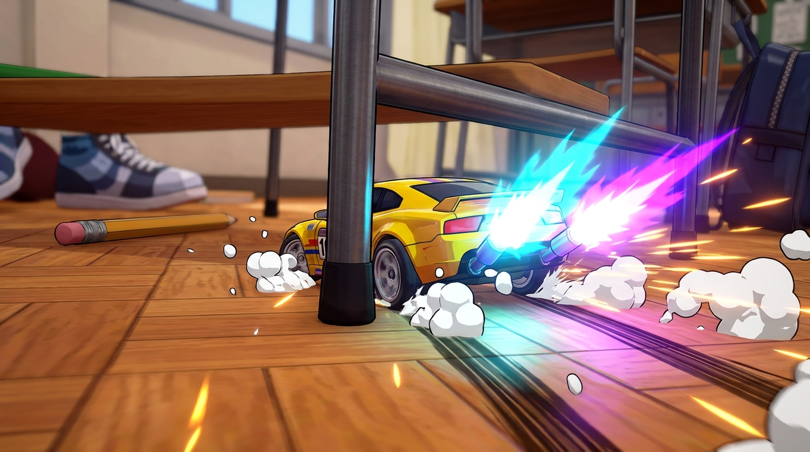
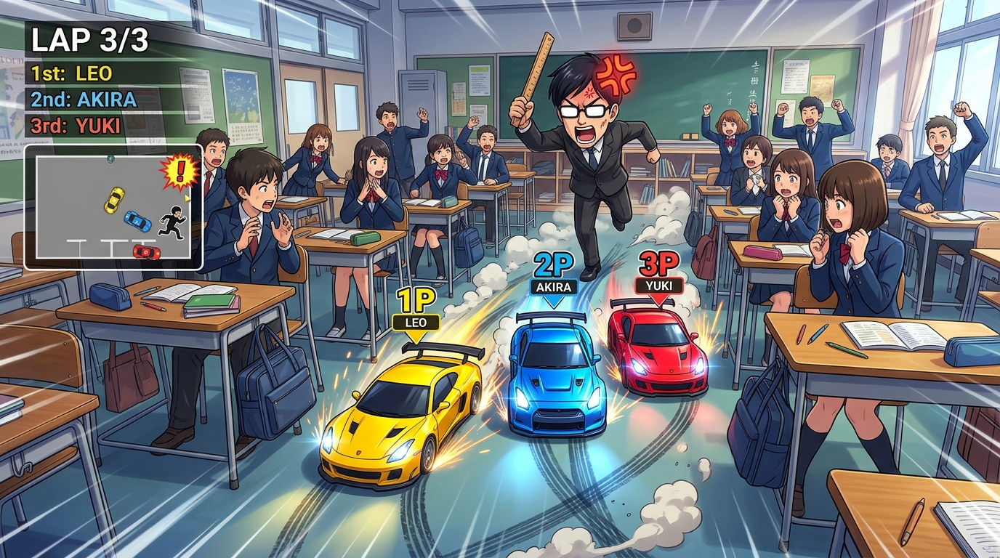

#  RC Car in Class

Play online or download the native Android app:

- **🌐 Play in Browser**: [https://jaihari2006.github.io/rc-car-in-class-/](https://jaihari2006.github.io/rc-car-in-class-/)
- **📱 Download Android APK**: [Download app-debug.apk](https://github.com/jaihari2006/rc-car-in-class-/releases/download/v1.0.0/app-debug.apk)
- **🏷️ GitHub Release**: [v1.0.0 Release Page](https://github.com/jaihari2006/rc-car-in-class-/releases/tag/v1.0.0)

---

## 📸 Screenshots & Artwork

| Official App Icon | Nitro Boost & Power Slide | Multiplayer Classroom Chase |
| :---: | :---: | :---: |
|  |  |  |

---

### Features
- **3D RC Car Physics & Drifting**: Responsive steering with sensitivity settings (`0.7x` to `1.7x`).
- **Nitro Boost**: Extended multi-tier exhaust flame plumes and anime speed lines.
- **Switchable Real Voice Packs**: Real downloadable and switchable voice packs for characters in **English** (`en`) and authentic **Japanese Anime** (`ja`) lines with in-app audio test preview.
- **3 Visual Texture Themes**:
  - **1st Old School Type**: Vintage wood classroom, chalkboard green, warm sepia sunlight, walnut desks.
  - **2nd Modern Type**: Sleek minimalist studio, white porcelain tiles, whiteboard with blue marker, daylight.
  - **3rd Futuristic Type**: Dark sci-fi cyber academy, neon cyan grid floor, holographic terminal board, neon cyan car underglow.
- **Clean Rounded UI Design**: Modern rounded cards, smooth pill badges, custom analog joystick, and responsive controls.
- **Anime Classroom Setting**: Parquet floor, chalkboards, desks, interactive students, and Sakamoto Sensei.
- **🔥 Fiery Sensi 3D Character Model**: High-detail Meshy AI 3D character with PBR materials, dynamic fiery ember aura, point lighting, running/walking bobbing animation, stun recovery, and ice/rage emissive reaction (switchable in Settings).
- **🌸 Sakura-kun (The Protagonist) 3D Character Model**: Authentic Meshy AI 3D anime protagonist character with signature two-tone blonde/red spiky hair, unbuttoned gakuran jacket, gold buttons, Chicago AJ1 sneakers, heroic spark aura, dynamic walking bob, and interactive cover/hide mechanics (switchable in Settings).
- **💙 Hinata-chan (Class Hero) 3D Character Model**: Authentic Meshy AI 3D heroine character with waist-length royal blue hair, white collared blouse, black bow tie, suspenders, high-waisted pleated skirt, silver hip chain, cerulean sparkle particle motes, hero light aura, dynamic walking bob, and interactive cover/hide mechanics (switchable in Settings).
- **🎓 Ren Sakuragi (Class Student NPC) 3D Character Model**: High-detail Meshy AI 3D student NPC character with classic buttoned gakuran school uniform, silver crest, gold buttons, crisp white sneakers, cool blue student lighting, and reactive dodging/fall animations (switchable in Settings).
- **🎀 Sakura Classmate (Class Female Student NPC) 3D Character Model**: High-detail Meshy AI 3D anime female student NPC character with classic school uniform, pleated skirt, white collared shirt, dark blazer, brown anime hairstyle, soft peach-pink ambient lighting, reactive walking bobbing, fall stun recovery, and interactive classroom mechanics (switchable in Settings).
- **🏎️ Blue Horizon Porsche 911 GTS 3D Car Model**: Authentic high-detail Meshy AI 3D vehicle model with metallic blue paint, aerodynamic curves, rear spoiler, dual exhaust pipes with reactive nitro flame plumes, front headlight projection, rear taillight glow, and neon underglow (switchable in Settings).
- **Top Classroom Camera**: Picture-in-picture bird's-eye view monitor.
- **Multiplayer Mode**: PeerJS networking with Room codes and playable Sensei tag role with virtual joystick and CATCH action.
- **Android APK**: Standalone Android application with native WebView and 100% offline assets.
