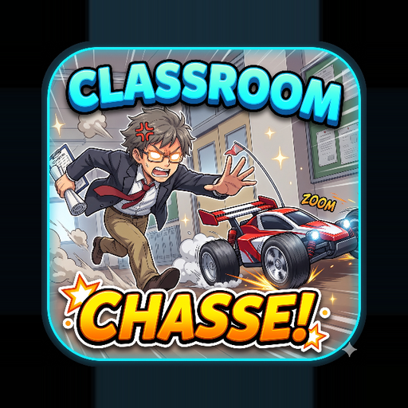
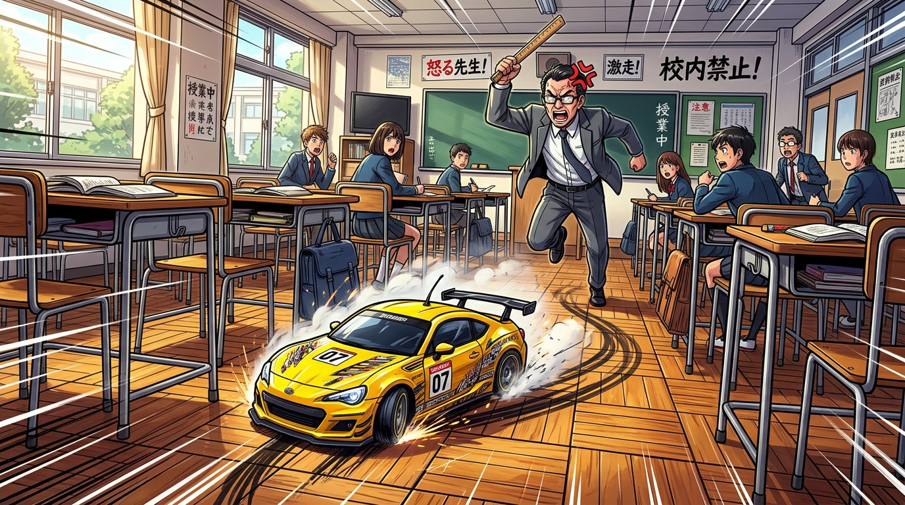
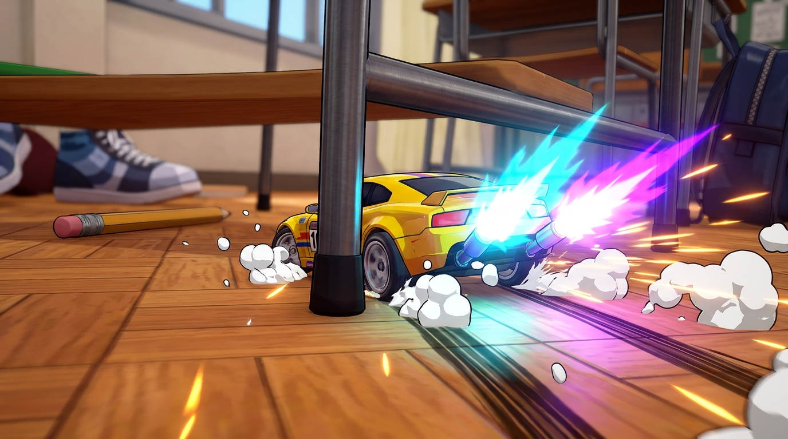
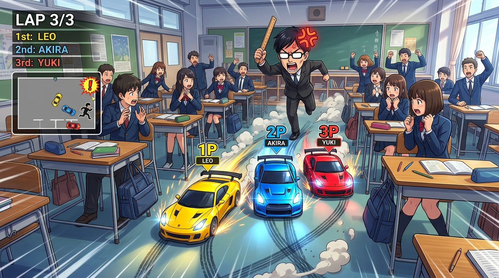

#  RC Car in Class

Play online or download the native Android app / Windows edition:

- **🌐 Play in Browser**: [https://jaihari2006.github.io/rc-car-in-class-/](https://jaihari2006.github.io/rc-car-in-class-/)
- **📱 Download Android APK**: [Download Rc.Car.in.Class.apk (v1.2.1)](https://github.com/jaihari2006/rc-car-in-class-/releases/download/v1.2.1/Rc.Car.in.Class.apk)
- **💻 Download Windows Edition**: [Download Rc.Car.in.Class-Windows-v1.2.1.zip (Portable 64-bit .exe)](https://github.com/jaihari2006/rc-car-in-class-/releases/download/v1.2.1/Rc.Car.in.Class-Windows-v1.2.1.zip) | [Windows Guide & Source](windows/README.md)
- **🏷️ GitHub Release**: [v1.2.1 Release Page](https://github.com/jaihari2006/rc-car-in-class-/releases/tag/v1.2.1)
- **🎮 Unreal Engine 5 Project Edition**: Full native Unreal Engine 5.4 project in [`RCCarInClass_Unreal/`](RCCarInClass_Unreal/) with Chaos vehicle physics, Sakamoto Sensei AI, and 3D PBR assets.

---

## 📸 Screenshots & Artwork

| Official App Icon | Nitro Boost & Power Slide | Multiplayer Classroom Chase |
| :---: | :---: | :---: |
|  |  |  |

---

### Features
- **🗺️ 4 Distinct Maps & Environments**:
  - **Homeroom 3-A**: Classic classroom with tidy desk rows, chalkboards, student clutter, and tight drift lanes.
  - **Chemistry Lab 101**: Granite resin lab benches, 6 breakable test tube racks (shatters on impact, confusing Sensei for 3 seconds!), 4 live Bunsen burners with thermal boost flames, and slingshot catapult pads.
  - **Central Academy Library**: Tall mahogany bookshelf maze, fragile book piles, oscillating ventilation fans, and a quiet noise meter that triggers Sensei's investigative sprint when making loud tire screeches!
  - **Sunset Rooftop Terrace**: Wide-open rooftop under twilight skies with 3 industrial HVAC draft units, 3 solar panel stunt ramps, and rainwater puddles causing slippery hydroplane drift slides.
- **👻 Ghost Car Replay & Time Trial System**:
  - High-fidelity holographic 3D ghost car with translucent cyan glow and 2D minimap shadow silhouette.
  - Real-time HUD delta split tracker (`▲ -0.35s` green ahead / `▼ +0.50s` red behind) comparing your current run against your Personal Best.
  - High-precision 80ms sampling with automatic spline interpolation and `localStorage` persistence per map and game mode.
  - Quick on/off toggle via top bar `[👻 GHOST]` button.
- **🧰 3 New Interactive Gadgets & Environmental Hazards**:
  - **Rubber Band Catapult Boost** (`R` / `B` / touch `[⚡ SLING]` / gamepad `B`/`RB`): launches car forward (`car.v += 6.5`) with elastic snap SFX, speed lines, and reactive floor slingshot boost pads.
  - **Electro-Magnet Collector** (`M` / `G` / touch `[🧲 MAGNET]` / gamepad `X`): activates a 240px tractor beam pulling homework papers and power-ups straight to your car for 6.0 seconds with electric hum SFX and magnetic particle aura.
  - **Turbofan Gale & Room Drafts** (`F` / touch `[🌪️ FAN]` / gamepad `LB`): blasts a supersonic shockwave pushing Sakamoto Sensei back by 110 units and scattering clutter, plus environmental oscillating desk fans and HVAC drafts.
- **🌐 Enhanced Online Multiplayer**:
  - **Quick Match Public Lobby Browser**: 1-click room browser with standard lobbies (`CL3A`, `LABX`, `LIBS`, `ROOF`) or custom room codes.
  - **Spectator Mode** (`C` / touch `[👁️ SPEC]`): spectate active racers or Sakamoto Sensei with cinematic 2D & 3D chase camera tracking.
  - **Quick Chat & Emote Wheel** (`T` / touch `[💬 CHAT]`): broadcast animated floating speech bubbles (`🏎️💨`, `⚡`, `😎`, `😂`, `🔥`, `😱`) across PeerJS peers.
- **📐 Ruler & Textbook Stunt Ramps**: Inclined wooden rulers stacked on colorful manga & textbooks scattered across the classroom. Hitting a ramp at speed triggers a 3D parabolic aerial jump (`car.airZ` up to 45 units), airtime score bonuses, landing sparks, and allows jumping directly over rows of desks or driving across desk-tops!
- **🦘 Bunny Hop Jump Action**: Tap `SPACE`, `J`, or the on-screen `[🦘 JUMP]` touch button (or Gamepad `Y` button) to execute an instant spring hop (`car.airZ = 19`) to hop over clutter, clear bags and balls, or dodge incoming student kicks mid-drift!
- **🖋️ Fountain Pen Ink Trap**: Tap `E`, `I`, or the `[🖋️ INK]` button to drop a glossy dark ink puddle behind your RC Car. When Sakamoto Sensei steps into the ink, he comically slips, spins out, and is knocked down for 2.8 seconds (`+150 SENSEI SLIPPED!`) with dedicated slip voice lines! (Charges recharge over time).
- **💨 Eraser Chalk Dust Smoke Screen**: Tap `Q`, `C`, or the `[💨 CHALK]` button to deploy an expanding cloud of chalk dust. Completely blinds and confuses Sensei (`+100 CHALK SCREEN!`), breaking line-of-sight and freezing his pursuit for 2.4 seconds while he coughs and sneezes!
- **🎮 Native Gamepad & Android Haptics**: Full plug-and-play controller support via HTML5 Gamepad API (Xbox, PlayStation, Bluetooth mobile controllers) with analog steering/throttle and dual-motor rumble haptics, plus tactile Android vibration pulses (`navigator.vibrate`) on drifts, jumps, crashes, and nitro boost!
- **🌈 Neon Underglow Color Customizer**: Personalize your RC Car in the Garage/Shop with 7 radiant neon underglow colors (Cyber Cyan, Tokyo Gold, Toxic Lime, Hot Pink, Ultra Violet, Crimson Red, Pure Xenon) with real-time 3D Three.js ground lighting!
- **🏁 4 Selectable Game Modes**: Choose your mode from the pre-race launcher:
  - **Classic Chase**: Standard classroom escape — collect homework papers and evade Sensei before the bell.
  - **Stealth Heist**: Undercover exam delivery — deliver secret test notes under desks to Sakura-kun, Hinata-chan, and Ren Sakuragi.
  - **Gymkhana Stunt**: 60-second time attack frenzy with extra ramps, chalk donut circles, and 2x stunt combo multipliers!
  - **Sensei Mayhem**: Non-stop adrenaline survival with a blazing fiery rage Sensei whose sprint speed accelerates over time!
- **🌅 5 Visual Environment Themes (Now with Sunset & Stormy Academy)**:
  - **1st Old School Type**: Vintage wood classroom, chalkboard green, warm sepia sunlight, walnut desks.
  - **2nd Modern Type**: Sleek minimalist studio, white porcelain tiles, whiteboard with blue marker, daylight.
  - **3rd Futuristic Type**: Dark sci-fi cyber academy, neon cyan grid floor, holographic terminal board, neon underglow.
  - **4th Sunset Golden Hour**: Warm amber sunset glow pouring through classroom windows, long dramatic shadows, honey oak desks, twilight cherry blossoms.
  - **5th Stormy Night Academy**: Midnight academy with wet slate reflections, rain tapping on glass, dynamic random lightning flashes that illuminate the room, and xenon car headlights.
- **⚡ Close Call Combo Multiplier**: Grazing inches past Sakamoto Sensei's legs at high speed triggers `⚡ CLOSE CALL! +75` with dynamic speed-lines, sound FX, and haptic rumble!
- **🏅 Driver Achievements & Badges**: Unlock badges displayed on your Driver Profile card: *Sky High* (Ramp Stunt Pro), *Ink Master* (Slipped Teacher), *Nitro Demon* (Drift Specialist), and *Ghost Driver* (Stealth Evader).
- **🦵 Character Panic Reactions (Kick & Throw to Half Classroom Distance)**: When the RC Car buzzes near student characters (Sakura-kun, Hinata-chan, Ren-kun, Classmates - except Sensei) and their panic/fear meter spikes (>=65% with sweat drop indicators `💦` and shivering), if Sakamoto Sensei is not nearby (>220 units away), there is a **20% chance** they will frantically react by either **kicking** (`💥 KICK!`) or **throwing** (`💨 THROW!`) the car across half the classroom distance (~440 units) with 3D aerial parabolic tumble, ground skid sparks, and spoken voice lines across English, Japanese, and Tamil!
- **🎙️ Dedicated Character Voice Module (95 Clips)**: Full offline neural voice acting across **English**, **Japanese Anime**, and **Tamil** for Sakamoto Sensei, Sakura-kun, Hinata-chan, Ren-kun, and Classmates. Includes dedicated Kick/Throw reactions, 3D directional stereo panning (`StereoPannerNode`), distance rolloff, speech bubble visualizers with dancing equalizer bars, and multi-character language previews.
- **🎓 Interactive Tutorial Level**: First-time launch onboarding with step-by-step driver training (Steering & Gas, Power Slide & Drift, Nitro Boost, and Sensei evasion) with S-Rank completion and replay anytime directly from Settings.
- **⏸️ Auto-Pause on App Switch**: The game automatically freezes race action, timer, physics, and audio when switching to other apps, opening recent tasks, or minimizing the window, letting you resume seamlessly when returning.
- **🖼️ Custom Homepage Backdrop & Streamlined Settings**: High-detail customized main menu backdrop with single-gear Settings access for quick tuning.
- **👤 First-Time Racer Profile Setup & Customization**: First launch interactive profile creator allowing racers to set their handle (with stylish randomizer), pick racing interests (Drift Specialist, Speed Demon, Sensei Evader, etc.), and view career stats anytime via the Home profile badge.
- **🖼️ 10 Avatar Presets & Device Photo Upload**: 10 hand-drawn themed avatars (Female Speed Queen, Male Turbo Drift, Teen Cyber Street, Middle Age Pro, Grandpa Nitro, Baby Racer, Pet Cat, Pet Dog, Pet Bunny, Robot Pet) plus device camera / physical photo upload with native Android WebView file picker support.
- **✨ Glowing Animated Logo & Splash Screen**: Glowing title branding, animated neon splash sequence on boot, and Android launcher app icons.
- **🔊 Audio Volume Mixer & Boosted Voices**: Separate audio sliders for Voice Volume, Engine Roar, SFX, and BGM, with boosted character dialog volume across all languages.
- **🎵 Ambient Wildlife Racing BGM**: Immersive background music soundtrack during high-speed classroom chases.
- **3D RC Car Physics & Drifting**: Responsive steering with sensitivity settings (`0.7x` to `1.7x`).
- **Nitro Boost**: Extended multi-tier exhaust flame plumes and anime speed lines.
- **Switchable Real Voice Packs**: Real downloadable and switchable voice packs for characters in **English** (`en`), authentic **Japanese Anime** (`ja`), and vibrant **Tamil** (`ta`) lines with in-app audio test preview.
- **3 Visual Texture Themes**:
  - **1st Old School Type**: Vintage wood classroom, chalkboard green, warm sepia sunlight, walnut desks.
  - **2nd Modern Type**: Sleek minimalist studio, white porcelain tiles, whiteboard with blue marker, daylight.
  - **3rd Futuristic Type**: Dark sci-fi cyber academy, neon cyan grid floor, holographic terminal board, neon cyan car underglow.
- **Clean Rounded UI Design**: Modern rounded cards, smooth pill badges, custom analog joystick, and responsive controls.
- **Anime Classroom Setting**: Parquet floor, chalkboards, desks, interactive students, and Sakamoto Sensei.
- **🔥 Fiery Sensei 3D Character Model**: High-detail Meshy AI 3D character with PBR materials, dynamic fiery ember aura, point lighting, running/walking bobbing animation, stun recovery, and ice/rage emissive reaction (switchable in Settings).
- **🌸 Sakura-kun (The Protagonist) 3D Character Model**: Authentic Meshy AI 3D anime protagonist character with signature two-tone blonde/red spiky hair, unbuttoned gakuran jacket, gold buttons, Chicago AJ1 sneakers, heroic spark aura, dynamic walking bob, and interactive cover/hide mechanics (switchable in Settings).
- **💙 Hinata-chan (Class Hero) 3D Character Model**: Authentic Meshy AI 3D heroine character with waist-length royal blue hair, white collared blouse, black bow tie, suspenders, high-waisted pleated skirt, silver hip chain, cerulean sparkle particle motes, hero light aura, dynamic walking bob, and interactive cover/hide mechanics (switchable in Settings).
- **🎓 Ren Sakuragi (Class Student NPC) 3D Character Model**: High-detail Meshy AI 3D student NPC character with classic buttoned gakuran school uniform, silver crest, gold buttons, crisp white sneakers, cool blue student lighting, and reactive dodging/fall animations (switchable in Settings).
- **🎀 Sakura Classmate (Class Female Student NPC) 3D Character Model**: High-detail Meshy AI 3D anime female student NPC character with classic school uniform, pleated skirt, white collared shirt, dark blazer, brown anime hairstyle, soft peach-pink ambient lighting, reactive walking bobbing, fall stun recovery, and interactive classroom mechanics (switchable in Settings).
- **🏎️ Blue Horizon Porsche 911 GTS 3D Car Model**: Authentic high-detail Meshy AI 3D vehicle model with metallic blue paint, aerodynamic curves, rear spoiler, dual exhaust pipes with reactive nitro flame plumes, front headlight projection, rear taillight glow, and neon underglow (switchable in Settings).
- **Top Classroom Camera**: Picture-in-picture bird's-eye view monitor.
- **Multiplayer Mode**: PeerJS networking with Room codes and playable Sensei tag role with virtual joystick and CATCH action.
- **Android APK**: Standalone Android application with native WebView and 100% offline assets.
